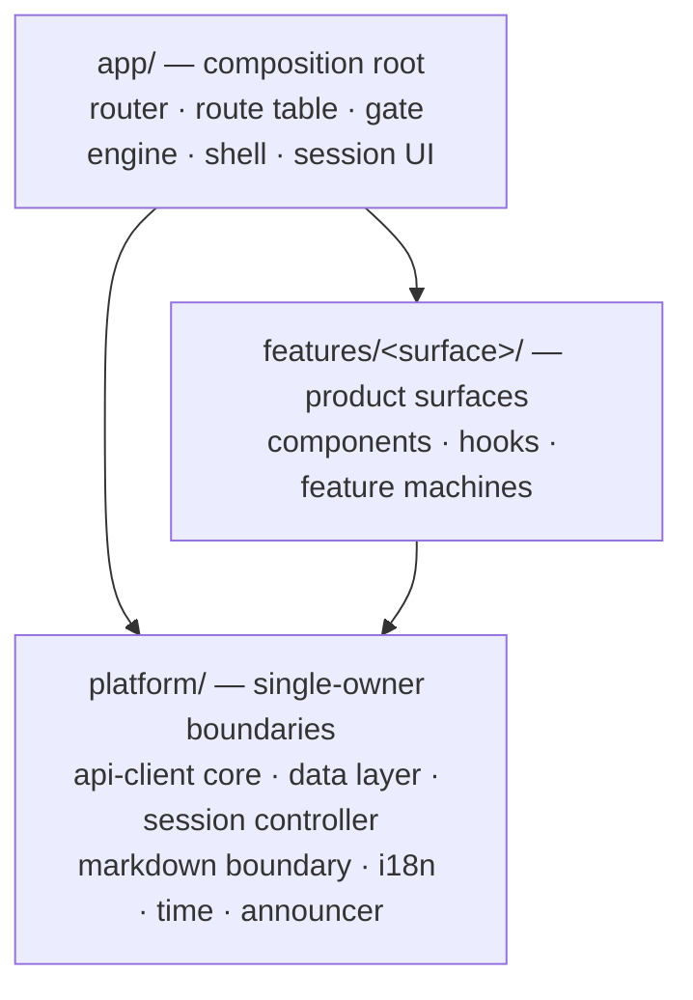

# Architecture Spine — mia-frontend

Behavioral contracts (state machines, routes, security, accessibility, styling) live in the planning artifacts and
`.agents/rules/`; this spine never restates them. It fixes only the architecture calls those documents left open.
This spine resolves `FRONTEND-PRD-FOUNDATION.md` Open Questions 1 (AD-2) and 2 (AD-6). Every decision here — including
each runtime dependency, the router, and the test runner — was explicitly decided by the product owner in the coaching
session of 2026-09-15 (memlog), satisfying `techstack.md`'s product-decision requirement.

## Design Paradigm

Delivery sequencing follows the PRD foundation's **Owner-approved tutoring-first milestone — 2026-10-06** and
`../../epics.md`. Reuse the implemented entry/session substrate; build transfer and tutoring-stream responsibilities
when their course-preparation and tutoring stories need them. Deferred surface families do not require speculative
infrastructure before the tutoring milestone. The architecture decisions below are unchanged.

Layered client architecture: three source tiers with one-way dependencies, where every cross-cutting concern has
exactly one owning module ("single-owner boundary") and features may only consume, never reimplement. Long-lived
stateful machinery is framework-independent: plain-TypeScript controllers exposed to React through one
`useSyncExternalStore` adapter each — never effect chains.



## Invariants & Rules

### AD-1 — Server state lives in one fenced TanStack Query data layer

- **Binds:** all
- **Prevents:** per-feature caches with divergent staleness, keying, and purge semantics; library defaults
  (refetch-on-focus, retries, optimistic helpers) re-enabled feature by feature.
- **Rule:** `@tanstack/react-query` may be imported only inside `platform/data`; enforce with ESLint
  `no-restricted-imports`. Features consume exported hooks only. `refetchOnWindowFocus` and `refetchOnReconnect` are
  globally off (lifecycle events only mark staleness); query-level retry is off (read-retry policy lives in the client
  core). Mount-time fetch of stale data stays on — surface entry is the sanctioned revalidation trigger per
  `api-client.md`. One key factory owns cache identity and every key carries account ID, operation, and full scope
  discriminators. Scope/security-epoch change funnels through one purge function. Optimistic helpers are never used.
  The cache is memory-only. Secret-bearing responses (recovery codes, MFA proofs, TOTP URIs) never enter this layer:
  they flow through a single-flight, no-store mutation path in the owning feature per `security-privacy.md`
  interception rules, and the client core provides that no-store call mode.

### AD-2 — API access is generated wire types + one hand-written client core + zod boundary schemas

- **Binds:** all network traffic except the SSE stream (AD-8)
- **Prevents:** two client stacks; hand-guessed transport; validation skipped or repeated per feature; generated hooks
  bypassing AD-1's fence.
- **Rule:** Wire types are generated from `mia/api-doc/openapi.yaml` by `openapi-typescript` (dev-time only; an
  operation absent from the generated types is blocked work). All requests flow through the single client core in
  `platform/api`, which owns fetch, CSRF, request-ID, the structurally non-inheritable read-retry policy, JSON:API
  parsing, and error mapping. Every response body is validated exactly once by a per-operation zod schema that emits
  the minimized camelCase view model; each schema is compile-checked against its generated wire type (`satisfies`).
  Exactly one schema and view model exist per operation, owned in `platform/api` — features import them and never
  define their own for an operation another feature may share. No full-client codegen. OpenAPI 3.2 support in the
  generator is empirical (verified by generation, not documented): the regeneration step diff-checks operation
  coverage, and a silently dropped operation or field is blocked work, not absent contract.

### AD-3 — Routing is React Router v8, declarative mode only

- **Binds:** all navigation
- **Prevents:** a second data-loading path via router loaders; router-level prefetching; framework-mode build takeover.
- **Rule:** Use declarative mode APIs only (`BrowserRouter`, `Routes`, `Link`, `useNavigate`, …). Router loaders,
  actions, and fetchers are never used; data flows only through AD-1/AD-2. Typed paths come from the route table
  (AD-4), never hand-built strings.

### AD-4 — One declarative route table + one gate engine own protected mounting

- **Binds:** every routed surface
- **Prevents:** per-surface gate implementations that reorder, skip, or vary the ordered access gate or invent variant
  existence-hiding presentations.
- **Rule:** `app/routes` holds the single route table — the code form of `ROUTE-INVENTORY.md`: canonical path, typed
  params, title, and gate requirements (minimum session stage, required capability/scope, existence-proving resource)
  as data. Every path has exactly one owning feature; requirements are declared as that entry's data, authored in
  `app/routes`, and the entry reaches its feature only through the lazy route-component import. One gate engine at the
  router layout level interprets those declarations in the fixed order, and owns the
  neutral checking shell, the single existence-hiding presentation, and epoch re-evaluation wired to AD-1's purge
  funnel. The same layer owns the single route-change sequencer (title update, then announcement, then focus, per
  `accessibility.md`) and teardown neutralization (neutral title, cleared content-bearing history state). Features
  declare requirements; they never implement gate or sequencing logic.

### AD-5 — Three tiers, one-way dependencies, promotion as the only sharing path

- **Binds:** all
- **Prevents:** feature-to-feature imports, platform reaching upward, shared code duplicated per feature or dumped in
  ambiguous `shared/` modules.
- **Rule:** `app` → `features` → `platform`; never backward; features never import each other (the route table reaches
  features only through lazy route-component imports). Enforce with ESLint import-boundary rules. The promotion target
  is always `platform`: infrastructure into the owning platform module, shared blueprint-bound UI composites into
  `platform/ui`, shared view models with their operation in `platform/api` (AD-2). `app` hosts composition only and is
  never a promotion destination. Promotion happens at the moment of second use.

### AD-6 — Untrusted content renders through one AST boundary; no HTML string stage exists

- **Binds:** all model output, user text, authored Markdown, filenames, backend error bodies
- **Prevents:** per-feature Markdown pipelines; sanitizer configuration drift; reintroduction of an `innerHTML` sink.
- **Rule:** `platform/markdown` is the only module that configures the pipeline: `react-markdown` rendering directly
  to React elements, allowlist expressed as its component map (heading demotion, external-link rules; everything else
  escaped text), tables via a table-only GFM extension composition (`micromark-extension-gfm-table` +
  `mdast-util-gfm-table` in a local remark plugin — never full `remark-gfm`, whose autolink literals cannot be
  disabled and would violate the no-autolink rule), math via `remark-math` + `rehype-katex` with KaTeX assets
  self-hosted. `rehype-raw` and any plugin
  addition outside this module are forbidden (`dangerouslySetInnerHTML` banned repo-wide via ESLint `react/no-danger`).
  The KaTeX-generated subtree is the single PO-approved exception to the
  sanitizer class/style ban — input HTML, SVG, and MathML remain banned, and the mandated math security fixtures gate
  the exception. Features consume only the exported `ModelMarkdown` / `UserText` components; `UserText` owns
  bidi/Unicode isolation of untrusted inline text. `dangerouslySetInnerHTML` appears nowhere in the codebase.

### AD-7 — One platform session controller owns stage, timers, and cross-tab state

- **Binds:** all
- **Prevents:** idle/absolute timers scattered through component effects; multiple `BroadcastChannel` protocols;
  accidental keepalives from background traffic.
- **Rule:** `platform/session` holds the singleton framework-independent controller: session-stage machine, per-tab
  observed authoritative deadlines, non-countdown warning, clock-rollback locks, cross-tab protocol, logout phase machine.
  React reads it via one `useSyncExternalStore` adapter; the warning/shield/logout UI lives in `app`. The client core
  requires `initiator: 'user' | 'background'` on every request. Neither provenance extends deadlines locally;
  only explicit Continue working refreshes backend idle expiry under the 2026-10-05 owner decision. All
  data-layer revalidation is hard-wired `'background'`. The controller is also the single security-epoch fan-out
  point: on epoch loss it invokes, in fixed order, transfer aborts (AD-14), the cache purge funnel (AD-1), then UI
  notification — subscribers never wire each other. Deadline shapes that depend on BCG-001 remain blocked, not
  guessed. Logout coordination covers known live work, including authentication transitions; it is not server-side
  per-browser revocation. Follow the 2026-09-27 owner decision in `FRONTEND-PRD-FOUNDATION.md` and the security
  companion's logout phases: confirmation is `204` plus subsequent anonymous discovery, independently checked per tab;
  late transitions require shielding and explicit reconciliation. No all-context atomic logout guarantee is assumed.

### AD-8 — The tutoring stream is a feature-owned controller outside the data layer

- **Binds:** `features/tutoring`
- **Prevents:** a speculative generic streaming layer; cache staleness semantics governing live streamed state.
- **Rule:** `features/tutoring` owns the stream controller (connection epoch, snapshot atomic replacement, event
  fencing, user-activated reconnect bound per `FRONTEND-STATE-MACHINES.md` §3–4) over native `EventSource`, exposed
  via one `useSyncExternalStore` adapter. Live stream state never enters TanStack Query; the terminal event's
  authoritative content is rendered per the contract, and any post-terminal read follows only the enumerated read
  triggers — no automatic refetch is invented. Event payloads are zod-validated; streamed text renders only through AD-6. If a
  second stream ever enters the OpenAPI contract, promote the transport shell to `platform` (AD-5) — never copy it.

### AD-9 — i18n is FormatJS/react-intl with ICU messages and compile-time completeness

- **Binds:** all frontend-owned copy
- **Prevents:** mixed message grammars; hand-rolled plural logic; catalogs whose completeness no gate checks.
- **Rule:** Messages are ICU MessageFormat with explicit stable IDs (no generated hash IDs). `platform/i18n` owns the
  provider, browser negotiation, the fallback table, and the atomic locale switch — which has exactly one entry point
  in `platform/i18n` that every trigger (pre-login selector, post-login preference, profile save) calls; any cross-tab
  propagation belongs to that entry point. Extraction and per-locale compilation run via `@formatjs/cli`; the full
  check fails on an incomplete catalog.

### AD-10 — Dates and numbers use platform `Intl` only

- **Binds:** all
- **Prevents:** a date library creeping in per feature; duplicate zone/DST logic.
- **Rule:** No date/time or number-formatting library. `platform/time` wraps `Intl.DateTimeFormat` and owns IANA-zone
  display, DST-gap rejection, and overlap offset choice; wire instants follow the api-client rule (RFC 3339 UTC).

### AD-11 — Tests run on Vitest + Testing Library + jsdom, with MSW as the protocol fake

- **Binds:** all non-E2E tests (Playwright E2E is fixed by `techstack.md`)
- **Prevents:** parallel test transform configs; per-suite hand-rolled fetch mocks that drift from the contract.
- **Rule:** `npm test` runs Vitest with jsdom and React Testing Library (+`user-event`). Network is faked only at the
  network layer via MSW, so client core, CSRF, zod boundaries, and the data layer run unmodified in integration tests.
  Tests are colocated `*.test.ts(x)`; shared handlers and fixture builders live in root `test/`, outside the `src`
  tiers, and redact secret-marked headers and bodies by construction so no failure output can print them; the
  secret-marker scan runs in the full check.

### AD-12 — Errors cross the client boundary as one discriminated union

- **Binds:** all
- **Prevents:** features branching on raw status numbers or response bodies; ambiguous outcomes coerced to success or
  failure.
- **Rule:** The client core emits a single discriminated error union carrying the stable backend error code and the
  raw-disclosure payload. Outcome-unknown (timeout or transport loss after an unsafe dispatch) is its own variant and
  is never resolved by guessing. Features branch only on the union.

### AD-13 — Code splits at the route table; nothing preloads

- **Binds:** all routed surfaces
- **Prevents:** ad-hoc lazy boundaries per feature; preload heuristics that violate the no-prefetch posture; protected
  surface code arriving during restricted stages.
- **Rule:** Every route-table entry references its component via `React.lazy` dynamic import — one chunk per surface,
  loaded after its gate passes. No preloading of any kind: no `modulepreload` for route chunks, no intent preload.
  Vite default chunking otherwise; `manualChunks` tuning only when the bundle-size assertion in the full check fails.

### AD-14 — One transfer boundary owns downloads, uploads, and authorized inline images

- **Binds:** all binary and file traffic
- **Prevents:** per-feature blob/object-URL lifecycles; upload progress hacked differently per surface; authorized
  images cached or surviving epoch change.
- **Rule:** `platform/transfer` owns app-managed fetch/blob downloads (abort and discard on security-epoch loss,
  object-URL revocation after use or boundary change), the browser-handoff warning path, upload transfers (XHR, the
  one sanctioned non-fetch transport, because `fetch` cannot report the required ≥1 Hz upload progress), and retrieval
  of separately gated inline images (avatars, course logos) that vanish on denial or epoch change. It wires into
  AD-7's epoch and AD-1's purge funnel. Features never construct object URLs or upload transports themselves.

### AD-15 — [ADOPTED] CSP ships as a `<meta http-equiv>` tag in `index.html`

- **Binds:** all
- **Prevents:** split CSP ownership across repos; policy drift between header and meta.
- **Rule:** The single CSP source is the meta tag in `index.html`: `default-src 'self'`; `script-src 'self'` (never
  `unsafe-inline`/`unsafe-eval`); fonts and styles local; `style-src-attr 'unsafe-inline'` for KaTeX output is a
  PO-approved relaxation (with AD-6's exception). The full check asserts the tag's presence and its locked directives.
  Accepted limitation, decided by the product owner: meta CSP cannot express `frame-ancestors` and covers only the
  document. If the backend ever serves a CSP header, the policy moves there and the meta tag is removed — never both.

## Consistency Conventions

| Concern | Convention |
| --- | --- |
| Long-lived stateful machinery | Plain-TS controller + one `useSyncExternalStore` adapter (AD-7, AD-8 set the pattern); never timer/effect chains in components |
| Cache identity | Only the `platform/data` key factory builds keys; account ID + operation + full scope discriminators, always |
| Request provenance | Every client-core call declares `initiator: 'user' \| 'background'`; only explicit Continue working refreshes backend idle expiry |
| View models | Boundary zod schemas emit minimized camelCase view models; components never see wire shapes (owned by `.agents/rules/api-client.md`, mechanized by AD-2) |
| Untrusted text | Only `ModelMarkdown` / `UserText` from `platform/markdown` (AD-6) |
| Message IDs | Explicit, stable, dot-namespaced by surface (e.g. `tutoring.composer.send`) |
| Forms | [ADOPTED] No form library — React 19 form Actions / `useActionState` / `useFormStatus` per `.agents/rules/react.md` |
| Fragment token | Captured pre-React in `main.tsx` into one route-local ephemeral object handed to `features/auth`; never router state, global store, or data layer |
| Text size | Three built-in modes applied as one root-level class scaling the rem base; control lives in the shell (pre-login discoverable), applied by `app` |
| Print | One default print-suppression stylesheet owned by `app` (sanctioned custom CSS per `tailwind.md`); codes-only recovery print is the sole opt-in |
| Class names | `clsx` + `tailwind-merge` helper and `prettier-plugin-tailwindcss` ordering per `tailwind.md` |
| Announcements | Only through `platform/announcer`'s exported API; `aria-live` regions exist only inside that module (ESLint fence) |
| Error boundaries | One route-tree boundary owned by `app/routes`; feature-region boundaries use the shared `platform/ui` boundary component, never hand-rolled |
| Browser storage | Only `platform/prefs` touches `localStorage`/`sessionStorage` (ESLint fence); it stores device-local UI preferences only (text size, pre-login locale) — never protected content |
| Fences | Every "only inside X" rule in this spine is enforced by an ESLint rule, not convention |

## Stack

Inherited and binding per `.agents/rules/techstack.md`: TypeScript strict, React 19.3, Vite 8, Tailwind CSS 4.3 +
Tailwind Plus, Playwright E2E, npm, Node current LTS. New selections below, verified current on npm 2026-09-15; pin
exact patch versions and re-verify current majors at implementation time (react-intl 12 landed the same day this was
verified).

| Name | Version |
| --- | --- |
| react-router (declarative mode) | 8.4.0 |
| @tanstack/react-query | 5.102.8 |
| zod | 4.6.5 |
| openapi-typescript (dev) | 7.13.0 |
| react-markdown | 10.1.0 |
| micromark-extension-gfm-table / mdast-util-gfm-table | 2.1.2 / 2.0.0 |
| remark-math / rehype-katex | 6.0.0 / 7.0.1 |
| katex | 0.18.7 |
| clsx / tailwind-merge | 2.1.1 / 3.7.0 |
| qrcode | 1.5.4 |
| prettier-plugin-tailwindcss (dev) | 0.8.1 |
| react-intl | 11.0.1 |
| @formatjs/cli (dev) | 6.16.29 |
| @headlessui/react / @heroicons/react | 2.2.10 / 2.2.0 |
| vitest (dev) | 5.0.1 |
| @testing-library/react / user-event (dev) | 16.3.3 / 14.6.7 |
| jsdom (dev) | 30.0.1 |
| msw (dev) | 2.15.0 |

## Structural Seed

```text
index.html            # meta CSP (AD-15); build identifier readable without auth
src/
  main.tsx            # fragment-token pre-React bootstrap, then app mount
  app/                # composition root: providers, shell chrome, session UI
    routes/           # route table (AD-4) + gate engine
  features/           # auth/ tutoring/ courses/ materials/ mentoring/ admin/ profile/ …
  platform/
    api/              # client core + generated wire types (AD-2)
    data/             # fenced TanStack Query layer + key factory + purge funnel (AD-1)
    session/          # session controller (AD-7)
    transfer/         # downloads, uploads, object URLs, authorized images (AD-14)
    markdown/         # locked rendering boundary (AD-6)
    i18n/             # provider, negotiation, catalogs, locale-switch entry point (AD-9)
    time/             # Intl wrappers (AD-10)
    ui/               # shared blueprint-bound composites, shared error-boundary component (AD-5)
    prefs/            # sole browser-storage reader/writer: device-local UI preferences
    announcer/        # single announcement arbitration owner (sole aria-live owner)
test/                 # MSW handlers, fixture builders (AD-11)
```

Deployment and environments are owned outside this repo: the production artifact is a static bundle served by the Go
backend from its document root with SPA fallback outside `/api` (`.agents/rules/techstack.md`); the frontend ships no
server, no container, no service worker. Development runs Vite's dev server with `/api` proxied to a local backend.

## Capability → Architecture Map

| Area | Lives in | Governed by |
| --- | --- | --- |
| Login, MFA, password-change stages | `features/auth` + `platform/session` | AD-4, AD-7 |
| Tutoring workspace + live stream | `features/tutoring` | AD-6, AD-8 |
| Courses, materials, uploads | `features/courses`, `features/materials` | AD-1, AD-2, AD-14 |
| Mentoring, supervision, admin | `features/mentoring`, `features/admin` | AD-4, AD-5 |
| Profile and locale | `features/profile` + `platform/i18n` | AD-9 |
| Text size, print, downloads | `app` shell + `platform/transfer` | AD-14, conventions |
| Shell, navigation, Home | `app` | AD-3, AD-4, AD-13 |
| Session expiry, logout, cross-tab | `platform/session` + `app` | AD-7 |
| Error surfaces, raw disclosure | `platform/api` + features | AD-2, AD-12 |

## Deferred

- **Performance measurement harness** — how the constrained-profile budgets (`FFR-951..956`) are measured is an open
  tooling selection; Vitest/jsdom cannot measure paint and Playwright's fixed scope is E2E flows. Revisit before the
  first release-readiness check; the enforcement point (the full check) is decided.
- **Exact CSP directive text** — written at implementation against the real bundle; revisit AD-15 if the backend ever
  serves a CSP header.
- **BCG-001-dependent session shapes** (deadline discovery, Continue-working response handling) — blocked on the
  backend contract; ownership is fixed by AD-7, shapes are not guessed.
- **Feature-internal folder structure** — the code owns it; AD-5 governs only the tier boundaries.
- **Zod schema organization and key-factory concrete shape** — code-owned detail inside `platform/api` / `platform/data`.
- **`manualChunks` tuning and lazy-loading the math pipeline** — only if the bundle-size assertion fails (AD-13).
- **Tailwind Plus blueprint binding** — a pre-implementation gate owned by `DESIGN.md`, not an architecture call.
- **Performance budget numbers** — provisional values owned by `FRONTEND-PRD-FOUNDATION.md`; this spine fixes only
  where they are enforced (the full check).
